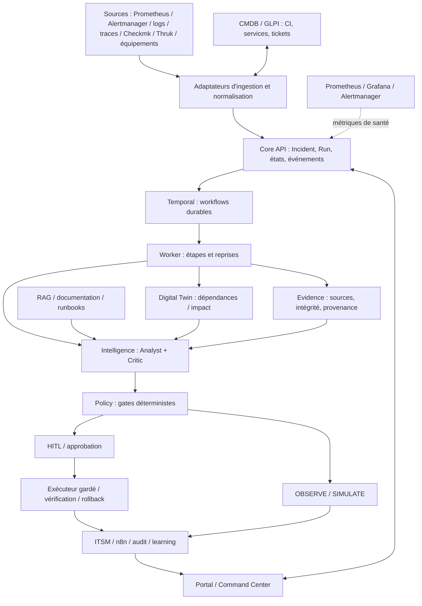

# AIOps2 — Dossier d'architecture de l'infrastructure cible
**Édition :** 2026-10-29 · **Périmètre :** ACME, Command Center, NOC, ITSM et plateforme AIOps2 · **Statut :** architecture cible et inventaire source, non attestation de déploiement.

> **Lecture importante.** « Cible » signifie architecture voulue. « Présent en source » signifie que des fichiers/routes ont été inspectés dans la branche `prep/acme-demo-offline-20261029`. « Déployé/qualifié » exige des preuves Debian, Compose, bases, API et E2E indépendantes. Le document ne constitue pas une validation de production.

## 1. Synthèse exécutive

AIOps2 vise à transformer les signaux d'exploitation hétérogènes (alertes, métriques, journaux, traces, CMDB, tickets) en une décision NOC contextualisée par le service métier, traçable et contrôlée. Le cas ACME relie une dégradation de la fabric SAN à un risque sur **Payments**. La valeur attendue n'est pas seulement une alerte de plus : elle est la réduction de l'incertitude, l'identification des dépendances, l'explication du diagnostic, la maîtrise des changements et la continuité d'activité.

**Capacités cibles :** supervision multi-sources ; inventaire et dépendances de services ; corrélation incident/run ; Evidence avec provenance ; Analyst/Critic ; Policy/HITL ; simulation et remédiation gouvernée ; ITSM/GLPI et communications n8n ; pilotage opérationnel et reporting ; observabilité du système lui-même.

**Limites connues :** aucune attestation actuelle d'un parcours complet ACME SAN→Payments→GLPI→remédiation→vérification sur le serveur cible ; pas d'autorisation LIVE ; couverture réelle des déploiements cron à confirmer.

## 2. Vue d'ensemble logique



**Principe d'autorité :** Core est le registre canonique Incident/Run ; Temporal porte l'orchestration ; Evidence porte les éléments probants ; Policy est indépendante du raisonnement LLM ; n8n transporte les intégrations sans devenir maître du Run ; le Portal ne doit pas écrire directement en PostgreSQL.

## 3. Cartographie des composants et contrats

| Domaine | Service ou composant | Responsabilité | Éléments identifiés dans le dépôt | Qualification à obtenir |
|---|---|---|---|---|
| Expérience | Portal / Command Center | Cockpit, timeline, Demo Studio, Copilot, Twin, Evidence, Policy | `app/portal/main.py` ; routes `/`, `/runs`, `/timeline`, `/twin`, `/evidence`, `/policy`, `/copilot`, `/demo-studio`, `/demo-studio/run/{rid}`, `/acme-stories`, `/policy-control` | Navigation, API, erreurs, sécurité, accès déployé |
| Autorité métier | Core | Incidents, runs, événements, décisions et état canonique | `app/core/main.py`, `app/core/demo_evidence_read.py` ; endpoints consommés par Portal | Auth, migrations, versioning, idempotence, E2E |
| Orchestration | Temporal + Worker | Workflows durables, reprises, étapes | `app/worker/main.py`, scripts E2E et runbook | Temporal connecté, reprise, double exécution interdite |
| Modèle métier | Digital Twin | CI, topologie, dépendances et impact potentiel | `app/twin/main.py` ; `/api/twin/graph`, `/api/twin/summary`, `/api/twin/impact/{node_id}` | Qualité des relations, ACL, fraîcheur et causalité |
| Preuve | Evidence | Enveloppe canonique, provenance, déduplication, hash | `app/evidence/main.py` ; `/api/evidence`, `/api/evidence/{eid}` | Auth, liaison au Run, intégrité, audit |
| IA | Analyst / Critic | Hypothèse, contestation, limites, preuves | `app/intelligence` (décrit dans architecture), registre Core `/ai-ledger` | Provider réel, qualité, contradictions, traçabilité |
| Sécurité | Policy | Gate, autonomie, simulation, décisions | `app/policy/main.py` ; `/api/policy/check`, `/api/policy/autonomy`, `/api/policy/simulation/summary` | Fencing, HITL, refus, audit, absence d'effets LIVE |
| Prévision | Remediation Lab | Recettes et projection avant/après | `app/shared/remediation_lab.py`, `acme_remediation_projection.py`, `acme_remediation_receipt.py` | Contrat Run, préconditions, postchecks observés |
| ITSM | GLPI | CI, tickets, changements, affectation | Stack et runbook GLPI ; intégration à auditer | Ticket ↔ incident ↔ run, statut, retries |
| Intégration | n8n | Notifications, synchronisation externe | Compose/runbook, frontière d'intégration | Webhooks, auth, idempotence, échecs |
| Observabilité | Prometheus, Grafana, Alertmanager | Métrologie, tableaux de bord et alertes | README/runbook ; `/metrics` sur services | Targets UP, dashboards, rétention |
| Connaissance | RAG/Copilot | Recherche de procédures, réponses contextualisées | Route Portal `/copilot` et service `COPILOT_URL` | Sources, droits, hallucinations, fraîcheur |
| Simulation | Simulator | Injection contrôlée DEMO/REPLAY/STORY | `app/simulator/main.py`, `/api/demo` avec gate | Isolée, reproductible, sans effet LIVE |

### 3.1 Portal et interfaces NOC

Le Portal utilise FastAPI et des vues HTML côté serveur. La page d'accueil agrège `Core /api/dashboard`, la liste des runs et le résumé Twin. `/timeline` permet de sélectionner un run, consulter les événements, le registre Analyst/Critic/Policy et les preuves associées. `/demo-studio` présente les sources Core/Twin, la topologie et les runs DEMO/REPLAY/STORY. `/demo-studio/run/{rid}` interroge Core pour le run, le registre IA et les gates ; le navigateur peut rafraîchir son état via `/api/demo-status/{rid}`.

Les vues `/evidence` et `/policy` sont encore partiellement des points de contrôle plutôt que des consoles fonctionnelles complètes. `/policy-control` lit les API Policy d'autonomie, d'historique et de simulation. La page `/acme-stories` porte des récits métier. L'ITSM n'est **pas** encore confirmé comme écran de bout en bout dans cette branche.

### 3.2 Core, événements et modèle canonique

Le modèle cible distingue : **Incident** (fait opérationnel et impact), **Run** (instance de traitement), **Run Event** (chronologie), **Evidence** (preuve identifiée), **Analysis/Critique** (raisonnements), **Policy Decision** (autorisation/refus), **Proposal** (action proposée), **Approval** (acteur et portée), **Effect** (action exécutée), **Verification** (résultat constaté), **Reconciliation** (cohérence) et **Learning** (capitalisation).

Les identifiants doivent rester stables, propagés de l'ingestion jusqu'au ticket ITSM et à la vue NOC. Les transitions exigent idempotence et contrôle de concurrence ; les événements et preuves sont append-only ; une action proposée n'est ni approuvée, ni exécutée, ni vérifiée.

### 3.3 Digital Twin et impact

Le Twin conserve des nœuds (ID, type, nom, site, état, criticité, santé, confiance) et des arêtes (source, cible, relation, redondance, confiance). Le code consulté documente des arêtes **consommateur → dépendance**. L'impact d'un nœud racine parcourt les consommateurs en sens inverse, jusqu'à huit niveaux, en n'utilisant que des arêtes présentes en base. Le résultat signifie **consommateurs potentiellement affectés**, pas panne métier observée. L'API annonce explicitement `runtime_impact_state=UNKNOWN`, `tenant_acl_qualified=false` et `live_remediation_authorized=false`.

Dans le scénario ACME, il faut vérifier les arêtes réellement stockées entre `ACME-SAN-FABRIC-A` et `ACME-SVC-PAYMENTS` avant d'afficher un chemin causal comme acquis.

### 3.4 Evidence, IA et gouvernance

Evidence expose une API authentifiée, avec `source`, `external_id`, `observed_at`, `known_at`, `claim`, `confidence`, `provenance`, `payload_hash` et `payload`. L'identité canonique sert à dédupliquer les relectures exactes et à refuser les collisions d'identifiant avec contenu différent. La réponse `/api/noc/runs/{rid}/evidence-refs` fournit des références synthétiques qualifiées de façon limitée ; elle ne prouve ni l'ACL tenant réelle ni l'attestation runtime.

L'Analyst doit expliquer la cause probable et citer les preuves ; le Critic doit tester contradictions, fraîcheur, couverture et hypothèses alternatives. Les sorties de modèle restent consultatives. Policy applique les barrières déterministes : en particulier, les effets LIVE ne sont pas qualifiés, et les simulations ne doivent jamais être interprétées comme des interventions effectives.

## 4. Infrastructure physique et logique cible

### 4.1 Hôte et mode de déploiement

Le dépôt décrit un hôte **Debian 13**, identifié historiquement `SRV-DEB-05`, avec Docker Compose mono-hôte. Il mentionne plusieurs générations AIOps déjà présentes : le déploiement cible doit donc être **isolé**, sans appropriation des conteneurs, réseaux ou volumes historiques. Le script `deploy/install-isolated.sh` choisit le projet `aiops2-rebuild`, crée une configuration dédiée, contrôle les ports et l'ownership Compose avant démarrage.

**Ce document n'infère pas** le CPU, la RAM, le stockage, les VLAN, les interfaces, l'hyperviseur, le nombre de nœuds ni les ressources GPU réellement disponibles : un inventaire système est nécessaire.

### 4.2 Services de persistance

- **PostgreSQL canonique** : incidents, runs, événements, Evidence, décisions, projections et audit selon les migrations. Prévoir sauvegarde, contrôle de schéma, immutabilité et restauration testée.
- **PostgreSQL Temporal** : base dédiée au moteur de workflow, distincte du registre canonique.
- **MariaDB GLPI** : stockage ITSM, à ne pas confondre avec le registre Core.
- **Volumes Docker nommés** : persistants, isolés par identité de projet. Leur existence, taille et politique de sauvegarde sont à vérifier sur l'hôte.
- **RAG et modèles** : emplacement de l'index, moteur vectoriel et ressources d'inférence non établis par les sources examinées.

### 4.3 Ports et publication réseau

| Service | Port standard documenté | Port isolé documenté | Exposition recommandée |
|---|---:|---:|---|
| Portal | 7777 | 17777 | Loopback + tunnel SSH / reverse proxy sécurisé |
| GLPI | 8080 | 18080 | Administration contrôlée |
| n8n | 5678 | 15678 | Administration contrôlée |
| Prometheus | 9090 | 19090 | Interne / administration |
| Grafana | 3000 | 13000 | Accès authentifié |
| Alertmanager | 9093 | 19093 | Interne / administration |
| Temporal gRPC | 7233 interne | Interne | Jamais exposé publiquement par défaut |

Ces ports proviennent du README et du runbook d'installation isolée, **pas d'un relevé de sockets actuellement ouvertes**. Le script fixe `AIOPS_BIND_IP=127.0.0.1` et autorise la personnalisation via variables `AIOPS_ISOLATED_*`. Les ports Core/Worker/Twin/Evidence/Policy sont internes et doivent être relevés dans le Compose effectif, non supposés.

### 4.4 Segmentation et flux

```text
[Opérateur / navigateur] -- HTTPS / SSH tunnel --> [Portal]
[Portal] -------------------------------> [Core, Twin, Copilot, Policy]
[Core] ---------------------------------> [PostgreSQL canonique]
[Core / Temporal] ----------------------> [Temporal / Worker]
[Worker] -------------------------------> [Evidence, Twin, Intelligence, Policy]
[Intégrations] -------------------------> [GLPI / n8n / sources observabilité]
[Prometheus] <--------------------------- [Endpoints /metrics autorisés]
[Simulator] -------- réseau d'exécution isolé, sans accès direct au réseau de données
```

Cible : séparation des réseaux **front-end**, **contrôle/orchestration**, **données**, **exécution/simulation** et **observabilité**. Les noms réels des réseaux Compose et les règles effectives doivent être audités ; ne pas interpréter ce découpage conceptuel comme une segmentation déjà prouvée.

## 5. Flux fonctionnels de bout en bout

### 5.1 Parcours ACME SAN → Payments

1. Un signal de supervision SAN (par exemple erreurs FC/CRC) arrive avec source, CI, horodatage et identifiant.
2. L'ingestion normalise et déduplique ; Core crée ou rattache un incident canonique.
3. Core crée un Run avec mode explicite, scénario, identifiant et clé d'idempotence.
4. Temporal/Worker orchestre enrichissement Twin/CMDB, collecte Evidence et raisonnement IA.
5. Le Twin cherche les consommateurs potentiellement dépendants de la fabric SAN, dont Payments si les relations sont présentes.
6. Analyst formule hypothèses, preuves et incertitudes ; Critic conteste ou valide les conditions minimales.
7. Policy rend un verdict déterministe, potentiellement `BLOCKED`, `OBSERVE` ou `SIMULATE`, sans effet LIVE.
8. Le NOC consulte la timeline, les preuves, les réserves et la proposition de remédiation.
9. L'intégration ITSM doit créer ou corréler un ticket GLPI, synchroniser statut/affectation et tracer les erreurs.
10. Une remédiation simulée peut illustrer avant/après et rollback hypothétique ; seuls des postchecks réellement observés pourraient attester une récupération.
11. L'audit relie incident, Run, preuves, décisions, ticket et vérification.

**Exemple de scénario de présentation, non télémétrie observée :** `ACME-SAN-FABRIC-A` → `ACME-SRV-RHEL01` → `ACME-SVC-PAYMENTS`, avec hausse CRC, chemin multipath dégradé, latence Payments accrue. Ces éléments sont présents comme observations déterministes dans `app/portal/qualification_lab.py` ; l'existence d'un chemin Twin complet doit être contrôlée indépendamment.

### 5.2 Ticket ITSM / GLPI

Le contrat cible d'un ticket lié à un Run comprend : `ticket_id`, `external_correlation_id`, `incident_id`, `run_id`, `service_id`, `ci_ids`, `priority`, `status`, `assignee/group`, `created_at`, `updated_at`, `evidence_refs`, `change_id`, `approval_ref`, `resolution_code`. Ce **contrat est une proposition d'architecture** ; il ne doit pas être présenté comme un schéma API GLPI déjà vérifié. Il faut vérifier l'adaptateur existant, l'authentification, les webhooks, la gestion des doublons, la reprise après timeout et la réconciliation bidirectionnelle.

### 5.3 Modes d'exploitation

| Mode | Usage | Effet sur infrastructure métier |
|---|---|---|
| OBSERVE | Acquisition et diagnostic | Aucun |
| DEMO / REPLAY / STORY | Scénarios contrôlés, auditables | Aucun effet LIVE |
| SIMULATE / WHAT-IF | Projection de remédiation | Aucun effet LIVE |
| LIVE | Actions sur environnement réel | **Non qualifié, fail-closed** |

## 6. Sécurité, identités et contrôles

**Authentification :** les services utilisent des jetons internes pour certaines API ; les valeurs doivent rester dans `.env` local avec permissions restrictives. L'authentification service-à-service ne prouve pas un RBAC multi-tenant complet. Les routes de démonstration avec mutation exigent une activation explicite et un jeton. Les interfaces de lecture ne doivent pas exposer de secrets ni d'identifiants sensibles.

**Autorisation d'action :** Policy doit rester indépendante de l'IA, avec contrôle de fraîcheur, préconditions, criticité, identité du demandeur, approbation humaine, ownership/fencing et vérification post-effet. `STOP_AUTO` doit pouvoir resserrer le niveau d'autonomie ; aucune interface de démonstration ne doit contourner ces barrières.

**Traçabilité :** distinguer `proposed`, `approved`, `executed`, `verified`, `reconciled`. Ne jamais afficher une projection `SIMULATED_SUCCESS` comme une guérison observée. Les états `UNKNOWN` et `BLOCKED` sont des résultats légitimes.

**Réseau :** interfaces d'administration sur loopback ou réseau privé ; reverse proxy/TLS/SSO si accès multi-utilisateurs ; règles explicites entre zones ; pas d'exposition directe de PostgreSQL, Temporal gRPC ni API internes sans décision d'architecture.

## 7. Exploitation, supervision et SRE

### 7.1 Mesures cibles

- Disponibilité des services et `/health`, durée des requêtes, taux d'erreur API.
- Nombre d'incidents ouverts, P1, runs actifs/bloqués, délais par étape.
- Lag Temporal, retries, timeouts, workers disponibles et échecs de workflow.
- Evidence : volume, erreurs d'ingestion, doublons, sources périmées, cohérence hash/Run.
- Intelligence : délai Analyst/Critic, refus de schéma, contradiction, grounding, provider indisponible.
- Policy : décisions BLOCKED, tentatives refusées, mode d'autonomie, opérations simulées.
- ITSM : tickets créés/corrélés, latence de synchronisation, webhooks échoués, doublons.
- Twin : nœuds/arêtes, CI orphelins, services isolés, fraîcheur des dépendances.
- Métier Payments : disponibilité, latence, taux d'échec, transactions en attente **si une source applicative autorisée les fournit**.

### 7.2 Tableaux de bord

**NOC directionnel :** santé des services critiques, incidents majeurs, exposition métier, âge et propriétaire des incidents, état des décisions. **NOC enquête :** timeline, preuves, diagnostic Analyst/Critic, dépendances, ticket GLPI et prochaine action. **Plateforme :** disponibilité API/Temporal/PostgreSQL, scrapes Prometheus, ressources hôte et sauvegardes. **Gouvernance :** refus Policy, demandes HITL, changements, audit et résultats de vérification.

### 7.3 SLO indicatifs à définir

Les seuils de disponibilité, latence, MTTA/MTTR, fraîcheur de preuves, RPO/RTO et durée de conservation ne sont **pas établis** par les sources consultées. Ils doivent être définis avec les propriétaires de service et mesurés, jamais inventés pour la démo.

## 8. Disponibilité, sauvegarde, restauration et capacité

L'installation documentée est **mono-hôte Compose**. Elle ne prouve ni haute disponibilité, ni réplication DB, ni PRA intersite. Pour une cible de production, prévoir explicitement : réplication PostgreSQL/Temporal selon support, sauvegardes chiffrées et testées, stockage dimensionné, reprise GLPI/MariaDB, redondance du proxy, surveillance des volumes, stratégie de mise à jour et exercice de restauration.

**Inventaire de capacité à relever** : vCPU, RAM, GPU et mémoire GPU (si modèle local), stockage et IOPS par volume, capacité PostgreSQL/Temporal/MariaDB, taux d'événements, débit Evidence, rétention logs/traces, nombre d'utilisateurs simultanés, dépendances réseau, bande passante et sauvegardes. Sans ces données, aucun sizing chiffré fiable n'est possible.

## 9. Déploiement et gestion des versions

### 9.1 Installation isolée documentée

Le dépôt recommande `bash deploy/install-isolated.sh` sur un hôte Debian avec stacks historiques. Le script utilise une identité Compose distincte, des ports alternatifs, une adresse loopback, des contrôles d'ownership et des secrets générés localement. Il vérifie `docker compose config`, le plan d'isolation et les ressources avant installation. `--configure-only` n'utilise pas Docker mais crée/ajuste `.env` : ce n'est donc **pas** une commande strictement sans effet sur fichiers.

### 9.2 Chaîne de livraison existante

Sur `SRV-DEB-05`, un cron Debian **toutes les cinq minutes** surveille la branche `deploy/aiops2-stable` (information opérateur). Il ne surveille pas la branche `prep/acme-demo-offline-20261029`. Son script exact, la liste des fichiers copiés, les éventuels redémarrages, le mécanisme `applied.sha` et le rollback doivent être inspectés avant toute promotion. Un commit GitHub sur prep **n'est pas** un déploiement.

### 9.3 Gates de promotion

1. Revue de diff, cohérence du packaging, sécurité des routes et absence de secrets.
2. Tests unitaires et statiques ciblés sur SHA exact.
3. Build Compose et migration sur environnement jetable, sans toucher aux stacks historiques.
4. E2E : Portal → Core → Temporal/Worker → Evidence/Analyst/Critic → Policy, sans effet LIVE.
5. Parcours métier NOC, impact Twin, ticket ITSM lié, Evidence et cas d'échec.
6. Vérification du déployeur stable-only et sauvegarde/rollback.
7. Après promotion autorisée : SHA appliqué, santé des conteneurs, smoke HTTP, captures et logs assainis.

**Preuves historiques :** 44 tests unitaires et 26 contrôles statiques ont été rapportés comme PASS sur une révision antérieure de la branche de préparation ; ces résultats ne qualifient pas les commits récents ni le runtime complet.

## 10. Plan d'acceptation par domaine

| Lot | Critère concret de recette | Preuve à collecter |
|---|---|---|
| Infra | Compose isolé, ownership et ports contrôlés | `docker compose ps`, plan d'isolation |
| API | Routes health et réponses authentifiées | Statuts HTTP, tests négatifs |
| Core | Incident P1 + Run + événements liés | IDs et lignes du registre |
| Twin | Dépendances ACME exactes, sans arêtes inventées | Graph + impact + qualité |
| Evidence | Références liées au même Run et hashes | API, source, known_at |
| IA | Analyst/Critic et réserves visibles | Ledger, provider et versions |
| Policy | Refus LIVE, SIMULATE explicite | Décision et tests de sécurité |
| ITSM | Ticket GLPI lié, idempotent, statut cohérent | ID réel dans GLPI + lien Run |
| Portal | Parcours de démo navigable | URL, smoke, captures |
| Observabilité | Targets UP et dashboards utiles | Prometheus targets + Grafana |
| Sauvegarde | Restauration sur cible jetable | Rapport et temps de reprise |
| Release | Version exacte en service | `applied.sha`, SHA GitHub, rollback |

## 11. Risques et lacunes prioritaires

| Priorité | Risque | Mesure |
|---|---|---|
| P0 | Démo racontée mais non raccordée aux services réels | Un seul parcours Portal avec Run, Twin, IA, Evidence, ITSM |
| P0 | Cron stable-only ou copie partielle des fichiers | Auditer le déployeur avant release |
| P0 | Ticket GLPI non corrélé | Inspecter adaptateurs existants et lier par `run_id` |
| P0 | Absence de preuve E2E actuelle | Test isolé, captures et rapport daté |
| P1 | Écart topologie ↔ impact réel | Afficher hypothèse et fraîcheur |
| P1 | Couverture RBAC/tenant incomplète | Fail-closed, auth et tests négatifs |
| P1 | Pas de postcondition réelle de remédiation | Ne montrer que projection SIMULATE |
| P1 | Monohôte sans PRA qualifié | Plan backup/restore et architecture HA cible |
| P2 | Sizing et SLO non définis | Inventaire, mesure et validation métier |

## 12. Matrice de traçabilité documentaire

| Source du dépôt | Ce qu'elle étaye |
|---|---|
| `README.md` | Architecture canonique, ports standard, commandes et principes |
| `docs/ARCHITECTURE-AND-BOUNDARIES.md` | Responsabilités, modèle cible, frontières et invariants |
| `docs/COMPONENT-CATALOG-AND-REUSE.md` | Catalogue, critères de réutilisation, historique v1/V145 |
| `docs/DEPLOYMENT-ISOLATED-REBUILD-RUNBOOK.md` | Services Compose, ports isolés, sécurité et recette |
| `deploy/install-isolated.sh` | Identité Compose, ports, préchecks et commandes exactes |
| `app/portal/main.py` | Routes du cockpit et appels Core/Twin/Policy |
| `app/twin/main.py` | Modèle de dépendances, API impact, limites de causalité |
| `app/evidence/main.py` | Contrat Evidence, hash, déduplication, auth |
| `app/policy/main.py` | Gates, modes, API d'autonomie et de simulation |
| `app/core/demo_evidence_read.py` | Qualification limitée des références Evidence synthétiques |
| `app/portal/qualification_lab.py` | Exemple déterministe SAN/Payments et observations |
| `docs/demo/JOURNAL-QUALIFICATION-2026-10-29.md` | Tests historiques, limites et reprise Debian |

## 13. Relevé de terrain à effectuer sans mutation

Pour passer de cette architecture cible à un **dossier d'infrastructure réellement installée**, recueillir en lecture seule, sur l'hôte autorisé :

- OS, kernel, CPU, RAM, disque, partitions, réseau, horloge et ressources GPU ;
- liste des projets Compose, conteneurs, versions d'images, santé, réseaux, volumes et ports publiés ;
- configuration Compose **expurgée des secrets**, service par service ;
- état des migrations, bases et sauvegardes (métadonnées uniquement) ;
- versions et statut des API Core/Portal/Twin/Evidence/Policy/GLPI/n8n ;
- cibles Prometheus, tableaux Grafana, Alertmanager et stockage de logs/traces ;
- script cron exact, ref stable, SHA appliqué, fichiers déployés et rollback ;
- topologie ACME réelle du Twin, Run DEMO représentatif, Evidence et ticket GLPI corrélé ;
- résultats datés des tests et smoke sur le SHA effectivement déployé.

**Ne pas exporter de secrets, dumps, journaux non expurgés ni données personnelles dans GitHub.**

---

**Conclusion.** La cible AIOps2 est un **système de pilotage de l'exploitation par les services métier** : les alertes sont corrélées à une topologie et à un Run, les preuves et décisions sont auditées, l'IA est contestable, Policy maîtrise les actions et GLPI/n8n assurent la continuité des processus ITSM. La priorité immédiate n'est pas de créer davantage de composants : c'est de prouver le raccordement de ceux déjà présents, sur une version déployée et identifiable.
