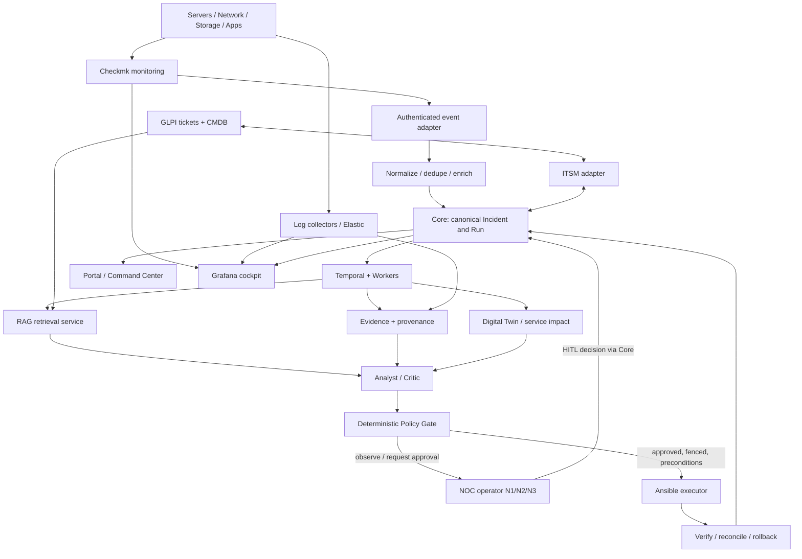

# ACME NOC 24/7 + AIOps 2.0 + RAG — Target architecture (HLD)
Status: **proposed design**, not proof of deployed integrations. Scope: on-premise, <1,000 devices, 24/7 NOC. No Thruk in the new target.
Date: 2026-10-28. Reviewers: NOC, SRE, SecOps, platform, ITSM, data/AI.

## Principles and ownership
- **Checkmk** owns active monitoring, service checks, acknowledgements and downtime; distributed sites only when justified by network segmentation.
- **Grafana** presents NOC dashboards and SLO trends; **Elastic** stores/searches selected logs. Avoid collecting identical telemetry twice without a retention/ownership decision.
- **Portal/Command Center** presents authenticated read models and operator decisions. It does not write databases or become an authoritative ticket/Run store.
- **Core** owns canonical Incident/Run identity and transitions. **Temporal/Worker** owns durable workflow execution. **n8n** handles integrations/notifications, not Run state. **Ansible** executes approved bounded playbooks.
- **GLPI** owns tickets and CMDB relations; explicit API adapter maps tickets and CI identities to Core with idempotency and reconciliation.
- **RAG** supplies advisory, access-controlled, source-cited knowledge; it never authorizes execution. **Evidence** owns append-only provenance, **Policy** gates actions, and **Twin** models dependencies/impact.
- **UNKNOWN** for missing/stale/conflicting facts. Preserve LIVE fail-closed, PC11K5 ownership/fencing, and strict DEMO/REPLAY/LIVE separation.

## Functional flow

## Security zones
| Zone | Components | Allowed paths (illustrative; validate actual ports) |
|---|---|---|
| Z1 monitored estate | endpoints, agents, exporters | outbound monitoring/telemetry to Z2; management initiated only from approved collectors |
| Z2 collection | Checkmk site(s), log forwarders, ingress | TLS to Z3 ingestion, no direct executor access |
| Z3 operations data | Core, Temporal, Evidence, Elastic, GLPI adapter, CMDB | authenticated service-to-service APIs, least privilege |
| Z4 intelligence | RAG API, vector index, embedding/LLM, Analyst/Critic, Twin | read-only scoped data retrieval; no direct production mutation |
| Z5 execution | Policy, approvals, n8n integrations, Ansible runners | narrow allowlisted egress through bastion to targets; audit all effects |
| Z6 presentation | Portal, Grafana, SSO/reverse proxy | operator SSO/MFA and RBAC; read-model access only |
| Z7 security/backup | Vault, PKI, audit, backup/PRA | restricted administration and restore paths |

No exposed internal API by default; separate service identities, secrets, network policies, TLS, encrypted backups, immutable audit and vulnerability management. Apply document ACL **before retrieval and before citations**; protect against prompt injection and sensitive data exfiltration.

## Event and identity contract
Required fields: schema_version, source, source_event_id, tenant, asset_id, service_id, event_time, ingestion_time, severity, state, dedupe_key, source_url, provenance, freshness, mode, canonical_incident_id, run_id (nullable), glpi_ticket_id (nullable), correlation_status, evidence_refs. Never infer real IDs from synthetic fixtures. Acknowledgement in Checkmk is not equivalent to GLPI ticket closure.

## NOC 24/7 functional process
1. Checkmk detects and routes an event; adapter validates signature/token, deduplicates and stamps source timestamps.
2. Core correlates CI/service against GLPI CMDB and incident identity; missing relationships remain UNKNOWN.
3. AIOps enriches with logs, Evidence, Twin and RAG citations; Analyst and Critic produce structured hypotheses.
4. N1 acknowledges, triages, assigns P1–P4 and escalates by policy; P1 invokes incident command and human authorization.
5. N2/N3 validate diagnosis and runbook. Policy checks freshness, impact, approvals, ownership/fencing, preconditions, idempotency.
6. Temporal executes only qualified activities; Ansible is invoked through an isolated executor. n8n may notify but does not control Run progression.
7. Verify service checks and business indicators, reconcile GLPI and Core; rollback or escalate on failure.
8. Record evidence, lessons learned, runbook update and NOC KPI review.

## RAG pipeline and controls
Sources: approved GLPI resolved incidents, KB, runbooks, CMDB exports, architecture docs, vendor references. Ingestion: connector -> ACL classification -> PII/secret redaction -> parsing/chunking -> version/hash -> embeddings -> vector + keyword index. Query: operator/tenant identity -> ACL-filtered hybrid retrieval -> rerank -> cited context -> local LLM -> structured response -> citation/freshness validation -> Evidence advisory record. Missing support -> UNKNOWN; synthetic fixtures must remain segregated. Evaluation: groundedness, citation validity, ACL leakage, stale-document behavior, prompt injection, latency and retrieval quality. Do not index raw production secrets.

## Capacity hypotheses — NOT sizing approval
Under 1,000 monitored assets; initial assumption 10–30 checks per asset (10k–30k checks), 1–5 GB/day logs, 30-day hot retention; measure actual metrics before procurement. Illustrative VMs: Checkmk 2 x (8 vCPU/16–32 GB), Grafana 2 x (2–4/4–8), Elastic 3 x (8–12/32–64), Core/Worker/Temporal 2–3 nodes (4–8/16–32), GLPI app 2 x (4/8), n8n 2 x (4/8), RAG API 2 x (4–8/16–32), vector DB 2–3 x (4–8/16–32), LLM inference 1–2 GPU hosts subject to model/latency tests. Databases, object storage, backup and load balancers need separate sizing. No SLA/HA promise without fault injection.

## Missing decisions / acceptance gates
- Checkmk edition/licensing, distributed monitoring design, event API/webhook choice, alert routing and acknowledgement sync.
- ACME asset inventory, critical service dependency map (SAN -> Payments), CMDB data owner, P1–P4 SLAs and escalation rota.
- Real NOC signed provider, identity mapping to Core Run and GLPI ticket; avoid MATCHED_UNATTESTED being treated as verified.
- RAG source ownership, tenant ACL model, embeddings/model choice, GPU budget, index refresh and retention.
- Elastic volume and hot/warm retention; HA topology, backup/PRA RPO/RTO, firewall matrix, SSO/MFA.
- Test cases: duplicated/out-of-order alerts, Checkmk outage, stale CMDB, mismatched Run IDs, missing citations, cross-tenant retrieval, policy denial, lost approval, failed effect, retry after worker restart, rollback failure.
- Promotion: source review -> unit/contract -> isolated integration -> synthetic E2E -> monitored staging -> approved LIVE pilot. LIVE remediation remains blocked until proven safe.

## Relationship to existing repo
Preserve README architecture and ADR-0001 through ADR-0017. Existing NOC signed read model and synthetic RAG fixtures are **not** live provider attestation. Reconcile with current open PRs before implementing; no service state or Debian deployment was inspected in this documentation change.
