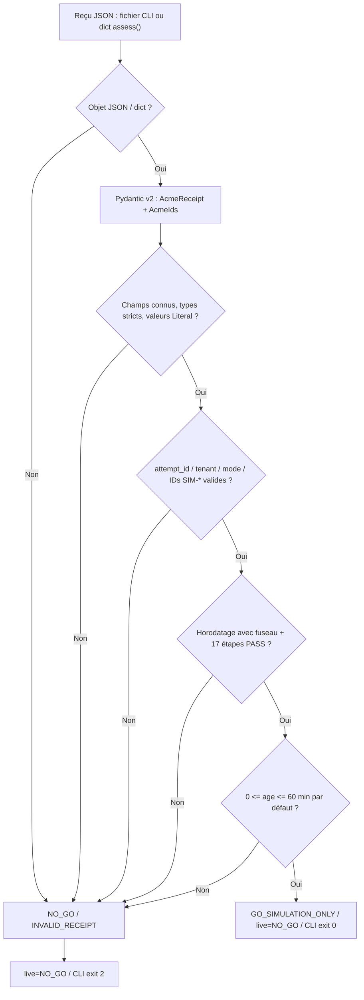

# ACME — Flux de validation des reçus Pydantic v2

**Statut : implémenté sur la branche de la PR draft [#805](https://github.com/alimtalbi-ata/aiops/pull/805), CI exacte à contrôler ; aucune qualification Debian/LIVE.**  
**Source de conception :** schéma et explication transmis le 17 novembre 2026 ; cette note décrit les différences réelles entre la proposition et le code de #805.

## Diagramme du gate

## Contrôles effectifs

| Contrôle | Mécanisme | Échec |
|---|---|---|
| Objet attendu | `assess(value)` exige un `dict` | `INVALID_RECEIPT` |
| Champs inconnus | `ConfigDict(extra="forbid", strict=True)` | `NO_GO` |
| `schema`, tenant, scénario, mode, status, reason | `Literal` | `NO_GO` |
| Identifiant de tentative | `^ACME-SIM-[A-F0-9]{16}$` | `NO_GO` |
| Ticket / approbation | `SIM-GLPI-` et `SIM-APP-` | `NO_GO` |
| Identifiants vides ou espaces seuls | `min_length` et validateur `nonblank` | `NO_GO` |
| Effets LIVE / GLPI réels / approbation humaine | `Literal[False]` | `NO_GO` |
| Mutations Docker | `Field(strict=True, ge=0, le=0)` | `NO_GO`, y compris `false` |
| Étapes | 17 clés obligatoires, valeur `PASS` | `NO_GO` |
| Fraîcheur | horodatage timezone-aware ; âge 0 à 60 minutes par défaut | `NO_GO` |
| Fenêtre de fraîcheur | entier 1 à 1440 minutes | `NO_GO` |
| Reçu trop volumineux au CLI | limite 65536 octets | `NO_GO` |

**Signature conservée :** `assess(value, now=None, max_age_minutes=60)`. Le CLI retourne 0 uniquement pour `GO_SIMULATION_ONLY` et 2 pour un reçu rejeté. `live` reste toujours `NO_GO`.

## Écarts corrigés par rapport au script proposé

- Le document proposait `docker_mutations: Literal[0]` ; l'implémentation utilise un **entier strict égal à zéro** pour empêcher qu'un booléen `false` soit accepté comme zéro.
- Les identifiants ne peuvent pas être uniquement composés d'espaces.
- Le code actuel utilise `model_validate_json(json.dumps(value))` afin de parser les dates ISO-8601 depuis JSON tout en appliquant les autres contraintes strictes.
- Les codes `reasons` sont construits à partir des chemins d'erreur Pydantic. Leur forme précise n'est pas nécessairement identique aux anciens codes ; seule la sémantique `NO_GO` est garantie par le contrat de base.
- La regex de `attempt_id` contrôle **un format**, pas l'authenticité ni l'impossibilité de falsifier un identifiant.

## Limites : ce que le modèle ne prouve pas

Un reçu syntaxiquement et sémantiquement valide n'est **pas une attestation de l'exécution**. La validation actuelle ne contrôle pas le SHA réellement exécuté, les liens causaux Core→Twin→Analyst/Critic, la concordance inter-étapes des identifiants, ni une signature cryptographique du reçu. Ces garanties restent **BLOCKED/NOT_TESTED**, suivies dans [#804](https://github.com/alimtalbi-ata/aiops/issues/804).

**Dépendance :** Pydantic v2 requis au moment de l'exécution du gate. Les appels du gate restent locaux/offline ; le provisionnement CI de Pydantic peut nécessiter le réseau. Aucun changement de conteneur Debian ou de service LIVE n'est impliqué par cette documentation.
