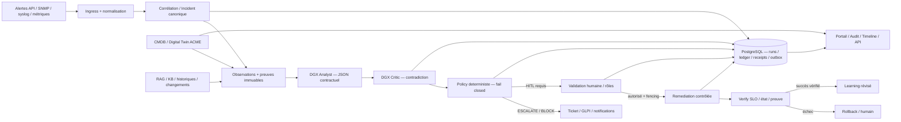
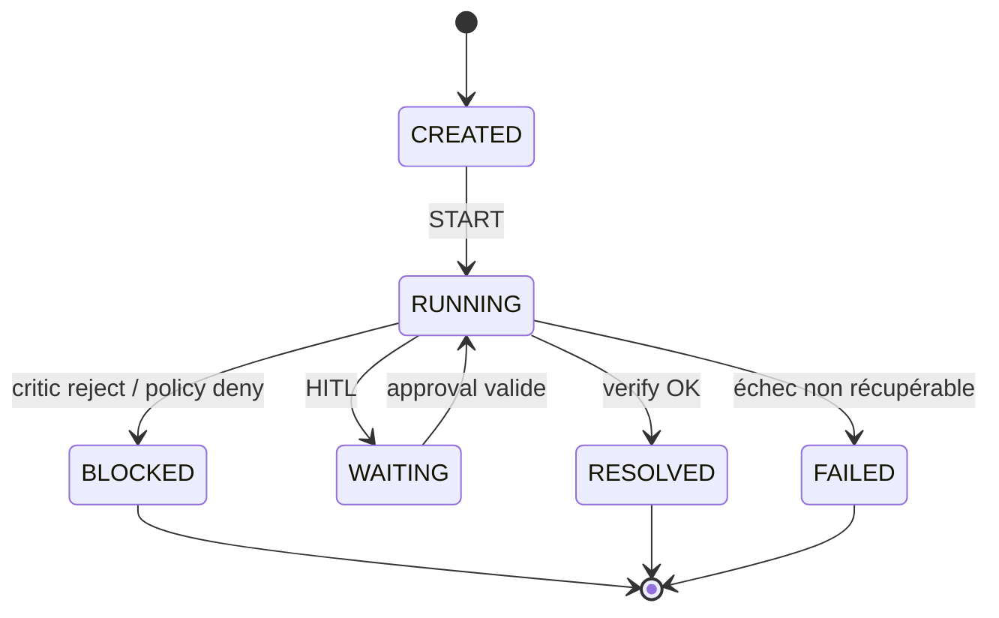

# AIOps 2.0 — Dossier d'architecture cible V2.8

**Auteur : Abdelhalim Talbi** · **Statut : architecture cible / candidat, pas une qualification production** · **Référence :** `docs/PROJECT-CONTINUITY.md` et PR #35 · **Date :** 20 octobre 2026.

## 1. Objectif et périmètre

Une plateforme AIOps 2.0 industrialisable, orientée exploitation d'infrastructures stockage, SAN, NAS et services métiers. La chaîne attendue : détection, normalisation, corrélation, contexte CMDB/Digital Twin, collecte de preuves, analyse IA Analyst, contradiction Critic, décision déterministe Policy, approbation HITL, remédiation éventuellement autorisée, vérification, rollback, capitalisation et audit. Les modes DEMO/STORY/REPLAY sont distincts du mode LIVE. **Ne pas confondre la cible et l'implémentation actuelle.**

### 1.1 Cas d'usage prioritaires

| UC | Déclencheur | Décision attendue | Preuves indispensables |
|---|---|---|---|
| UC01 — Panne port FC | Perte de lien switch SAN/hôte ESXi | P1 selon impact, escalade, aucune action risquée sans validation | traps, compteurs ports, zoning, multipath, CMDB |
| UC02 — Dégradation latence baie | Latence au-delà du SLO | Corrélation baie/volume/hôtes/application, diagnostic critique | séries temporelles, logs, seuils, contexte de changement |
| UC03 — Multipath dégradé | Un chemin restant | Blocage de toute remédiation non approuvée | chemins, redondance, topologie |
| UC04 — Réplication hors RPO | SRDF/équivalent lag élevé | Détection du service et du PRA à risque | RPO déclaré, timestamp, link status |
| UC05 — Capacité NAS/SAN | Seuil, croissance, backlog | Prévision, ticket, recommandations sans effet immédiat | consommation, tendances, QoS |
| UC06 — Critic rejette RCA | critique.validated=false | BLOCKED atomique, journal/receipt/outbox, aucune action LIVE | liens analyse/critique/evidence, empreinte de policy |
| UC07 — Digital Twin ACME | scénario SYNTHETIC sur fabric | Graphe, propagation d'impact, timeline, recommandations bloquées | nœuds/arêtes, horodatage, traces synthétiques explicites |
| UC08 — Coupure/interruption Temporal | reprise après événement persistant | reprise déterministe, pas de double IA ni transition | checkpoints, run events, version, receipt, outbox |
| UC09 — Analyst/Critic contestables | question utilisateur | réponse liée aux sources, hypothèses, confiance, limites | modèle, version prompts, preuves citées et rejouables |

## 2. Architecture logique

### 2.1 Services et responsabilités

| Domaine | Service / persistance | Responsabilité cible | Frontière de confiance |
|---|---|---|---|
| API Core | FastAPI + PostgreSQL | source canonique run, événements versionnés, états, reçus, outbox | token interne, transaction SQL et optimistic version |
| Worker | Temporal Python activities | exécution retryable, checkpoint, reprise fiable | idempotence Core, aucune décision d'autorisation locale |
| Intelligence | OpenAI-compatible Analyst/Critic | analyse traçable, JSON structuré | sorties non fiables avant validations |
| Evidence | registre de preuves | provenance, fraîcheur, référence evidence_id | distinguer SYNTHETIC/LIVE, timestamp source |
| Policy | contrôle déterministe | allow / block / HITL / escalate | interdiction du fail-open et des défauts permissifs |
| Digital Twin | PostgreSQL nodes/edges/facts | topologie dépendances et impact | qualité, temps de validité et provenance des liens |
| Simulator | DEMO/REPLAY/STORY | injection synthétique à graine fixe, comparaison | isolation réseau et données |
| Copilot | interaction contextualisée | demander preuves, challenger Analyst, expliquer Policy | lecture seulement par défaut, aucune élévation implicite |
| Portal | FastAPI HTML + CSS commun | cockpit, incidents, timeline, twin, evidence, policy, audit | proxy API contrôlé et sortie HTML échappée |
| HITL / ITSM | GLPI + connecteur | double contrôle, ticket, ownership | RBAC, jetons à durée limitée et traçabilité |
| Observabilité | Prometheus / Grafana / logs | latences, succès, retries, error budget, flux | pas de secrets, métriques cardinalité bornée |

### 2.2 État métier et sécurité

La table des transitions réelles est souveraine : ce schéma représente la **cible conceptuelle**, non toutes les transitions implémentées. Refus Critic : `CRITIC_COMPLETED` persistant et snapshot immuable → préparation du journal → transaction RUNNING→BLOCKED avec command receipt, event, outbox et COMMITTED. Les rejouements comparent un hash canonique. Transaction DB obligatoire. Toute incohérence interdit l'action.

## 3. Architecture de déploiement cible

- **Qualification :** stacks V2.8 exclusivement isolées, PostgreSQL de qualification séparé, réseaux non reliés à V2.6/V2.7, images immuables taggées avec SHA, secrets éphémères hors Git. Pas de port hôte ouvert sans besoin explicite.
- **Production future :** HTTPS/TLS en frontal, authn OIDC et RBAC, séparation plan public/contrôle/exécution/données, TLS interservices/mTLS si faisable, sauvegarde et restauration exercées, HA PostgreSQL et Temporal selon RTO/RPO, registry d'images signées, rétentions.
- **Tiers :** UI/portail ; Core/worker/Policy ; AI/model gateway ; données (PostgreSQL, Evidence, Twin) ; ITSM/observabilité ; interfaces équipements via gateways dédiées.
- **Sécurité :** machine identity, least privilege, aucune clé statique dans HTML/JS, journal d'audit append-only, hash/version des décisions, contrôle humain indépendant, contrôle d'ownership/fencing PC11K5, pas de remédiation LIVE avant qualification complète.
- **DR/backup :** cohérence PostgreSQL/WAL + restauration testée, Temporal history, snapshots documentés, manifest SHA256, rollback des releases sans migration destructive.

## 4. Modèle de données canonique

`incident` → `run` → `run_events` / `run_stage_state` → `evidence` → `analysis_records` → `critique_records` → `policy_decisions` → `approval/effect/verification`; sur refus : `critic_denial_resume`, `command_receipts`, `critic_denial_outbox`. Twin : `twin_nodes`, `twin_edges`, `twin_facts`, `observations`.

Chaque entité inclut provenance, run_id, mode, modèle/contrat, horodatage, lien de causalité et confiance le cas échéant. Les changements de faits Twin doivent distinguer valid-time et known-time. Les noms précis des colonnes restent à valider par migration et catalogue SQL.

## 5. Contrats et invariants d'architecture

1. Modes DEMO/REPLAY/STORY vs LIVE jamais confondus, visuellement et par API.
2. Journaliser la sortie Critic avant toute transition; reprise sans régénération IA après événement commité.
3. Rejets Policy non autorisables automatiquement; HITL à preuve forte et révocable.
4. Un effet nécessite ownership non périmé, fencing, préconditions et idempotency key; jamais `execute` implicite.
5. Incident, evidence, décision, ticket et effet doivent être corrélés par IDs traçables.
6. UI : aucun KPI inventé ni mesure d'exemple présentée comme réelle; valeur manquante = `INCONNU`.
7. Disponibilité de service ≠ qualification fonctionnelle : `/health` seul ne vaut pas E2E.
8. Sécurité UI : escaping HTML, absence de secrets injectés, CSRF/RBAC à qualifier sur endpoints qui modifient l'état.
9. SLO de production non fixés sans exercice réel; mesurer p50/p95 par étape, MTTD/MTTR, coûts/jetons, taux HITL, précision RCA, rollback.
10. Pas de migration ou redémarrage sur V2.6/V2.7 depuis la branche candidate.

## 6. Design system et architecture des portails

Adopter `docs/architecture/PORTAL-DESIGN-SYSTEM.md` comme standard : modèle HTML de référence fourni par l'utilisateur, réutilisé sans recopier les métriques/événements fictifs. Même shell sur **Accueil / Incidents / Runs-Timeline / Digital Twin / Observabilité & Evidence / Analyst-Critic / Policy-HITL / Remédiation & Verify / Audit & Reconciliation / Copilot / Administration / Démonstration**. Navigation clavier/mobile, thème clair/sombre, contrastes WCAG AA visés, animation désactivable via `prefers-reduced-motion`, visualisation de statut fiable. Chaque page annonce le mode et le niveau de preuve.

## 7. Qualification et critères de promotion

| Couverture | État rapporté au 20/10/2026 | Complément requis |
|---|---|---|
| Unit V2.8 | 35/35 PASS sur Debian isolée, rapporté par l'opérateur | revalider sur SHA de commit + CI |
| Import Docker Core | PASS après correction package | CI sur image candidate |
| HTTP auth Core | 401/401/409 attendus, PASS | negative tests RBAC et injection |
| HTTP blocage / replay QF188 | PASS (1 événement transition, 1 receipt, 1 outbox) | fixture réexécutable sans collision |
| Concurrence QF189 | 8/8 HTTP 200, une transaction + 7 replays | concurrence inter-processus / Worker |
| Réponse perdue QF190 | PASS simulation fermeture client | crash serveur réel et reprise Temporal |
| Digital Twin ACME E2E | NON QUALIFIÉ | scénario topologie → evidence → AI → Policy → UI |
| Appels modèle local/DGX | NON QUALIFIÉ | sorties réelles et golden set |
| LIVE / production | NO-GO | revue sécurité, approbation, rollback, runbooks, perf |

## 8. Lots de livraison cible

- **L1 — Sécurité transactionnelle :** verrouillage/replay/critic denial + CI + tests HTTP/Temporal.
- **L2 — Portails unifiés :** kit CSS/HTML réutilisable, routes et pages homogènes, états de chargement/erreur.
- **L3 — Digital Twin ACME :** graphe orienté, time travel, scénario de panne, impact service, preuves.
- **L4 — IA observable :** Copilot conversationnel grounded, Analyst/Critic, citations et niveaux de confiance, RAG.
- **L5 — HITL & remédiation contrôlée :** préconditions, fencing, décision, validation, effet, rollback.
- **L6 — Produit :** SSO/RBAC, multisite, packaging, DR, bench, documentation Word/PDF et qualification complète.

**NO-GO production jusqu'à réussite des gates et validation explicite.**
