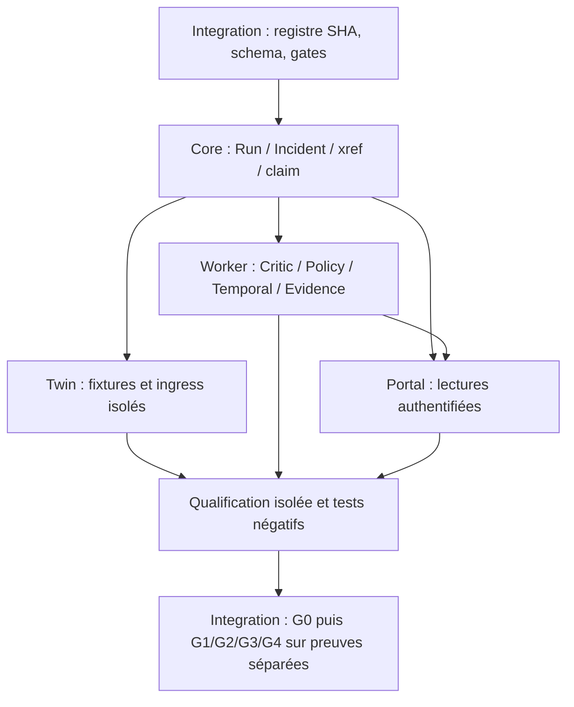

# Intégration / architecture / qualification — #462

UTC de qualification : 2026-11-08T16:59:30Z. Branche : `agent/integration/462-gates`.
Issue : https://github.com/alimtalbi-ata/aiops/issues/462 ; parent #457.
Base figée : `adcceb74bfd6289c161e344382e19be7952e3859`, contrat candidat #456.
Le commit contenant ce rapport se résout par `git log -1 --format=%H -- docs/handoffs/integration/462-gates.md` ; le handoff de publication indique le HEAD exact, sans SHA futur inventé.

**Décision globale : HOLD.** Qualification documentaire et tests locaux utilisables ; aucune intégration applicative, aucun déploiement, aucun E2E réel attesté. FS1250 GLPI/Core reste HOLD. Les cinq rôles sont des responsabilités, pas la preuve de cinq exécuteurs actifs.

## Périmètre, sources et propriété

AGENTS.md et contrat d’orchestration lus sur #456 ; continuité, catalogue et inventaire transversal consultés. Issues #457–#462 lues via leurs pages publiques, y compris le commentaire Twin du parent. Références existantes récupérées avant toute écriture : **488 branches et 438 refs de PR** au relevé ; les listes figées figurent dans [qualification-462](qualification-462/). Ce dénombrement ne signifie pas revue exhaustive du code des 488 branches ou des 438 PR. Treize PR ciblées inspectées avec état, base, head et chemins ; aucun développement déclaré absent sur la seule base de l’arbre d’audit.

Seuls `docs/handoffs/integration/462-gates.md` et `docs/handoffs/integration/qualification-462/**` sont ajoutés. Aucun fichier source, test existant, manifeste, lockfile, workflow, cron, Compose ou branche d’un autre rôle modifié. L’arbre initial était propre. Le handoff `docs/handoffs/integration/latest.md` de #457 est préservé sur sa branche, pour éviter une collision documentaire. Aucun agent secondaire lancé, aucune commande distante exécutée.

La base #456 est une **base de revue proposée**, pas une base de release approuvée. PR #455 et #456 ciblent `audit/preserve-debian-48h-20261108` ; ne pas prendre cette branche comme reflet exhaustif du projet. La PR #462 doit rester brouillon, empilée sur la branche d’orchestration pour isoler son diff ; si la base convenue change, refaire les contrôles du diff et des dépendances avant retargeting.

## Matrice CODE / CI / DEBIAN / E2E

PASS est limité au périmètre explicitement contrôlé. HOLD = preuves partielles ou sélection non autorisée ; BLOCKED = obstacle concret identifié ; UNKNOWN = preuve absente. Un job sauté/annulé n’est jamais un succès ; un refus Policy sûr n’est pas une panne.

| Axe / candidat | CODE | CI au SHA figé | DEBIAN | E2E | Justification |
| --- | --- | --- | --- | --- | --- |
| Core #458 : classificateur et gate #454 | PASS ciblé | PASS visible | UNKNOWN | HOLD | 13+10 tests purs ; ni readback GLPI réel ni claim PG16 transactionnel attestés |
| Core HITL #450 | PASS ciblé | PASS visible | UNKNOWN | HOLD | 34 tests purs HITL/Temporal/Evidence ; transaction, signal et reprise après crash non exercés |
| Worker #459 / candidat #443 | HOLD | PASS visible #443 ; #459 UNKNOWN | UNKNOWN | HOLD | 37 tests bridge/service et 29 tests actor ; callbacks simulés ; conflit d’entrée avec #446 et claim durable manquant |
| Twin #460 / #453 | HOLD | HOLD | UNKNOWN | HOLD | 25 tests synthétiques ; échecs CI database-migrations/quality-build-package ; pas de preuve ingress réel |
| Portal #461 | BLOCKED | UNKNOWN au SHA #461 | UNKNOWN | HOLD | 10 tests locaux passent, mais composition avec le producteur casse le contrat de reçu ; ni montage authentifié ni FS1113 navigateur vérifiés |
| Intégration #462 / #455 / #456 | PASS documentaire et contrôles ciblés | PASS visible #455/#456 ; nouveau HEAD #462 UNKNOWN avant PR | HOLD | HOLD | 245 tests locaux ; provenance Debian périmée et non reliée aux images ; publication GitHub par API bloquée |
| FS1250 : ticket observé #201 / Core | HOLD | UNKNOWN pour l’image installée | HOLD | HOLD | L’observation UI n’est pas une référence ITSM vérifiée ; aucun readback authentifié indépendant fourni |

Les états CI visibles ne certifient ni la politique complète de checks requis ni le contenu des logs authentifiés. Les tests locaux ne remplacent pas GitHub Actions. Aucun E2E réel déclaré PASS ; aucun résultat absent transformé en échec fonctionnel.

### Sources exactes sélectionnées

| Usage | Branche | SHA complet | PR / état observé |
| --- | --- | --- | --- |
| Base coordination | `ops/aiops2-multiagent-orchestration-20261108` | `adcceb74bfd6289c161e344382e19be7952e3859` | #456 DRAFT |
| Diagnostic ITSM non attestant | `fix/fs1250-itsm-identity-audit` | `23d8fc6dbd0b78ab36c82bfbca2d363918355858` | #455 DRAFT |
| Core classification | `core/fs147-fs1250-reconcile-20261108` | `87f0c5746a9d78f1e3696ecfe73bbeea8278eefb` | #454 DRAFT |
| Core HITL/fencing | `core/fs147-native-hitl-fencing-20261107` | `f2f45c37e052c76cb9d3b521b5c70c96a69c0679` | #450 DRAFT |
| Worker bridge/service | `worker/fs147-policy-adapter-20261106` | `338636c55233233c16d941ba541212edf779f2f6` | #443 DRAFT |
| Worker claim/actor | `worker/fs147-readonly-pipeline-actor-binding-20261106` | `578c46e31fb543a682c710d3502ee18aa005a00e` | candidat réutilisé, aucun numéro de PR supposé |
| Worker handoff | `agent/worker/459-pipeline` | `fe4963577fd52173388d487bf0b2bf4a7a35becd` | documentation BLOCKED, pas de changement applicatif |
| Twin qualification | `feat/fs147-twin-adapter-qualification-20261108` | `d99f552a2e48b9dcdd0bbda585e1d1339c670576` | #453 DRAFT |
| Portal sélection HOLD | `agent/portal/461-live-hold-selection` | `de58b7ac7ff43d46df4db37caceaf3712f1882fa` | candidat #461 (contient le commit fonctionnel e928b773…), PR non établie |
| Xref GLPI authentifié candidat | `fix/core-xref-glpi-readback-gate-20261101` | `00dd0443d4d36d7aeb36bb77490777ac6ef5785d` | #242 DRAFT |
| Migration xref 012 | `integration/core-xref-migration-012-20261031` | `0c07090bed333e90aab1248ffcfc51e10d3f3c67` | #212 DRAFT |

Autres sources préservées : #438 projection Portal, #446 garde Worker, #448 métriques Twin (MERGED observé), #449 gate de reçus, #451 isolation SAN/FS, client GLPI historique `feat/glpi-ai-ticket-enrichment-e2e`. Ce client sait créer/modifier des tickets : aucune méthode appelée ici. Le classificateur #454 et le diagnostic #455 ne sont pas des writers et ne réparent pas automatiquement un xref.

## Vérification CI indépendante de la prose des PR

Source : pages publiques `https://github.com/alimtalbi-ata/aiops/commit/<SHA_COMPLET>/checks`, états des jobs et URLs Actions consignés dans [ci-checks.json](qualification-462/ci-checks.json). Le SHA provient des métadonnées publiques PR, recoupé avec les références Git. L’API REST est refusée (403 du proxy), mais ce repli en lecture permet la vérification des états visibles au commit demandé. Les nombres ci-dessous comptent des jobs, pas des tests indépendants. Plusieurs runs push/PR peuvent se recouvrir.

| PR | État des jobs visibles | Décision CI |
| --- | --- | --- |
| #212 | 3 succès | PASS visible |
| #242 | 5 succès, 1 annulé | HOLD conservateur ; établir le run requis le plus récent avant promotion |
| #438 / #443 | 3 succès chacun | PASS visible ; #438 n’est pas le SHA du nouveau Portal #461 |
| #446 | 12 succès, 2 échecs database-migrations, 2 skips release-kit | HOLD |
| #448 | 6 succès, PR MERGED | PASS visible ; ne prouve pas l’image déployée |
| #449 | 8 succès, échecs quality-build-package et runtime-e2e, 1 skip | HOLD |
| #450 | 3 succès au nouveau head f2f45c37… | PASS visible ; ne pas reprendre un résultat du précédent head ab06382a… |
| #451 | 12 succès, 2 échecs database-migrations, 2 skips | HOLD |
| #453 | 11 succès, 3 échecs dont 2 database-migrations et quality-build-package, 2 skips | HOLD |
| #454 | 3 succès | PASS visible |
| #455 | 7 succès | PASS visible |
| #456 | 4 succès | PASS visible |

Exemple de mauvais rattachement évité : le run `42447158204`, cité dans l’historique #449, affiche le titre Core/HITL et le préfixe de commit `2695648`, pas le head #449 `a1f6d18e…`. Un lien de run dans un commentaire ne qualifie donc pas son head. Les causes détaillées des échecs nécessitent les logs et leur réexécution dans les branches propriétaires ; elles ne sont pas corrigées ici.

## Contrats et dépendances

Twin est un banc interchangeable de scénarios, pas un prérequis du moteur LIVE. Ses fixtures peuvent être qualifiées en parallèle après gel des identités. Les cinq responsabilités se rejoignent dans le registre Integration, pas par des imports croisés de fixtures dans la production.

| Contrat | Existant vérifié / limite | Blocage et propriétaire suivant |
| --- | --- | --- |
| Run / Incident | `app/shared/domain.py` fixe modes LIVE/DEMO/REPLAY/STORY, transitions et états terminaux ; #454 conserve tenant/run/incident/ticket | Core #458 : versionner la portée tenant + instance GLPI ; ne pas assimiler le mode SIMULATED d’un reçu au mode d’un Run |
| ITSM / GLPI | #242 lecture xref scoped, #454 classifier pur, #455 JSON reste HOLD même cohérent | Core + Integration : readback authentifié Ticket/Entity/CI, corrélation indépendante et xref existant ; jamais créer un ticket pour compenser l’absence du lien |
| Claim / idempotence | Root `worker/fs147_readonly_pipeline.py`, callback claim atomique supposé ; #450 documente transaction et outbox | Core : garantir durablement unicité, ownership/epoch, transaction et reprise ambiguë sur PG16 jetable ; Worker : preuve concurrence/restart sans double dispatch |
| Policy / Critic | Tests refus et STOP_AUTO ; #443 lie la réponse Policy au Run ; entrée stricte disponible séparément | Worker : raccorder les transports stricts authentifiés au vrai point d’entrée ; ne pas qualifier le chemin permissif/stubbé par les seuls tests stricts |
| HITL / Temporal | #450 contrat action/run/ticket/digest/expiration et réconciliation ; 34 tests purs | Core/Worker : prouver lease/outbox/état Temporal autoritatifs ; DENY ou STOP_AUTO ne déclenchent aucun signal ; besoin humain ≠ approbation |
| Evidence | Identité/provenance testées ; récépissé cohérent ≠ contenu indépendant | Worker/Core : fournir readback du contenu, empreinte, producteur, fraîcheur et liaison immuable au même Run |
| Digital Twin | #451/#453 graphes et namespaces SAN/FS, clés/URI imbriquées, replay négatif | Twin : porter/qualifier au véritable ingress candidat ; fonction définie dans un test ≠ garde déployée |
| Reçu producteur → Core → Portal | Producteur `utc`, checks `name/status/evidence/next_action` ; Core #454 consomme ce schéma | **BLOCKED Portal** : attend `collected_at`, `id/reason` et `owner/component`. Reproduction ci-dessous ; arbitrage de schéma requis avant intégration |
| Projection opérateur | #438 opt-in, #461 sélection de HOLD ; absence de preuve reste UNKNOWN/UNVERIFIED | Portal : ACL tenant/actor, route same-origin, véritable montage et Chromium FS1113 ; les tests DOM ne prouvent pas l’auth HTTP |

### Incompatibilité reproduite, sans mock du consommateur

[receipt-compatibility.json](qualification-462/receipt-compatibility.json) compose le vrai `summarize` de la base avec les modules Core #454 et Portal #461 exportés par SHA. Aucun appel réseau ni Docker exécuté :

1. Un reçu frais produit par `summarize` est reconnu HOLD par Core.
2. Le même objet donne `UNVERIFIED / timestamp_missing` au Portal.
3. Renommer seulement `utc` en `collected_at` ne suffit pas : `first_portal_hold` retourne `UNVERIFIED / no_actionable_portal_hold` faute d’attribution explicite ; les items n’ont pas non plus `id/reason`.

Décision d’interface proposée : conserver `aiops2-live-usecase-qualification-v1` comme source, choisir un adaptateur Portal explicite et testé en composition, ou proposer un nouveau schéma versionné. Ne pas deviner l’owner d’un HOLD ni transformer un refus Policy en défaut Portal. Core accepte jusque 60 s de décalage futur, Portal 30 s : harmoniser/documenter cette divergence ; ne pas élargir les tolérances silencieusement. Pas de correction dans les fichiers possédés par Portal.

## Collisions et arbitrage proposé

[Path overlaps](qualification-462/path-overlaps.json) compare chaque PR à sa base figée :

- #212 et #449 : `.github/workflows/quality.yml`. Consolider les exigences dans une revue séparée ; aucun nouveau workflow ici.
- #451 et #453 : `tests/test_fs147_twin_san_isolation_contract.py` et `docs/FS147-TWIN-SAN-ISOLATION-2026-11-07.md`. #453 est à comparer à #451, conserver ses tests négatifs supplémentaires ; ne pas intégrer deux fois la même pile.
- #459 demande `app/worker/**` mais l’implémentation réutilisable est sous `worker/**` ; #446 modifie déjà `app/worker/main.py`. Proposition d’arbitrage : réserver les modules purs `worker/fs147_*` à #459, laisser l’entrée #446 inchangée ; tout raccordement à `app/worker/main.py` attend un handoff conjoint Core/Worker et une PR additive dédiée. Ce rapport ne modifie aucune réservation distante.
- #450 et #454 : contrats Core connexes ; pas de collision directe de chemins observée dans leurs diffs de PR, mais transaction/xref/admission doivent partager les mêmes identités et statuts.
- #212/#242 : migration xref déplacée 009→012 ; la base actuelle n’a que 000–008. Valider la chaîne 009/010/011/012 et le schéma installé avant tout candidat ; aucun DDL exécuté.
- `docs/handoffs/integration/latest.md` est déjà produit par #457 : livrer #462 séparément, consolidation canonique après revue.

Un chevauchement de chemins est une collision de revue, pas la preuve d’un conflit textuel Git. Les branches historiques empilées peuvent porter des changements hérités hors rôle : éviter tout cherry-pick ou merge global sans réduction du diff. Aucun merge de travail ou de production réalisé.

## Debian : provenance, fraîcheur et limites

Branche distante `ops/debian-runtime-reports`, commit `ba0806e07f6d3750c8c2a4daf15ce0b19b615f5c`.
Fichier `ops/debian-reports/SRV-DEB-05/latest.json`, blob `bfc9985dd5deb5d586f12fe6ac5a0d06bdb02d90`.
SHA-256 du contenu : `c8583bf9d69df5497145193a332e14bd996e841982e92f5c8f2f8bc53e4e7057`.
Collecte `2026-11-08T16:53:01.379176Z` ; évaluation `16:58:58.857942Z` : **357,48 s, STALE au seuil 180 s**. Nouvelle lecture Git à `16:59:29Z` : même commit, âge **388,57 s**, toujours périmé. Ce n’est pas la preuve que le reporter s’est arrêté ; seule la copie Git accessible est datée. La fraîcheur n’est jamais permanente.

Reporter déclaré `aiops-debian-readonly` 1.0.0, hôte déclaré SRV-DEB-05, Debian 13 ; Docker déclaré disponible, inventaire non tronqué. Core/Worker/Evidence/Policy/Temporal rapportés running/healthy ; Portal et Twin running sans healthcheck. Images Core `fs1212-integrated-candidate`, Worker `fs-demo-candidate-20261105`, Portal `fs1073-csp-candidate`, Twin `fs1009-decimal-metrics-candidate-20261106`. Les noms ne sont ni des digests immuables ni une preuve de déploiement du candidat.

Absent de ce reçu : mapping source/build/image, image digest, Compose project et configuration qualifiée, état des migrations, signature indépendante, lineage E2E, readback GLPI authentifié. `latest-usecase.json` absent au chemin attendu dans l’arbre Git consulté ; ce constat signifie UNKNOWN et non panne fonctionnelle. Les ports loopback rapportés ne permettent pas d’inférer la santé des réseaux internes Compose.

Les observations FS1250 (Run `RUN-8CA56A39E58944F1`, Incident `INC-FS1250-AUTOGLPI-625916362ACD42C9`, ticket UI #201, 44 liens historiques, Policy BLOCKED) proviennent de l’inventaire antérieur, **pas d’une nouvelle lecture GLPI/PG ici**. Elles restent des pistes datées. Ne pas altérer les 44 liens ni les cinq stacks. Un run refusé peut rendre Temporal/HITL NOT_APPLICABLE ; cela ne démontre pas un parcours d’exécution autorisée.

## Tests réellement exécutés

Python 3.12.14, Node 24.22.1 ; venv isolé `/workspace/aiops-462-venv`, dépendances applicatives épinglées + httpx 0.28.1 et pytest 8.4.2. Candidats exportés par `git archive <SHA>` sous `/tmp/462-candidates/<rôle>`, sans checkout ni modification de branches propriétaires. Pas de worktree supplémentaire créé. Logs et commandes exactes : [test-results.json](qualification-462/test-results.json).

| Suite existante | Résultat |
| --- | --- |
| Audit statique base | PASS |
| Provenance Debian / comparaison / adaptation / jointure | 27 PASS |
| Cohérence reçu FS147 | 10 PASS, release reste HOLD |
| Synthèse usecase / refus / NOT_APPLICABLE | 10 PASS |
| Core classification + fraîcheur reçu | 13 + 10 PASS |
| Worker bridge + service + corrélation Policy | 37 PASS |
| Worker actor/claim/short-circuit | 29 PASS |
| Twin provenance imbriquée / isolation | 25 PASS |
| Portal reçu frais/périmé/futur + sélection HOLD | 10 PASS |
| Diagnostic ITSM #455 | 26 PASS |
| Policy sécurité | 14 PASS |
| Core HITL / réconciliation / signal / Evidence | 34 PASS |
| **Total** | **245 tests PASS, aucun skip/échec dans ces commandes** |

Les suites requises ici qualifient l’audit, les contrats purs et les refus. Aucune suite PostgreSQL réelle, Temporal réel, GLPI réel, images Docker ou navigateur n’a été exécutée dans #462. Ces vérifications restent obligatoires aux gates suivants, pas remplacées par compile/format/static. Le test de composition détecte le défaut malgré les tests unitaires Portal passants. Aucun nouveau test qui imite l’implémentation n’a été ajouté.

## Ordre d’intégration et prochains propriétaires

1. **Integration / #457** : confirmer la base de revue #456 et les réservations de chemins ; maintenir les PR brouillons et geler les SHA retenus. Rétablir l’API GitHub pour PR/commentaires et logs ; ne pas demander un nouveau token sur le seul refus réseau.
2. **Core / #458** : choisir les contrats #212/#242/#450/#454, figer tenant/instance/run/incident/evidence/action et les versions ; qualifier la chaîne DB sur PG16 jetable. Aucune migration de production. Restaurer l’interface native lecture GLPI sans réinventer le client ni appeler ses writers.
3. **Worker / #459 avec Core** : intégrer seulement les modules sélectionnés après #446 ; brancher claim durable/Policy stricte/Critic/Evidence ; tests concurrence, replay et crash entre commit/outbox/dispatch. Tout résultat ambigu reste UNKNOWN sans répétition d’effet.
4. **Twin / #460** : réutiliser les ajouts #453 par rapport à #451, corriger les jobs en échec dans sa branche ; tester ingress et provenance sur fixtures isolées. Ce travail peut avancer en parallèle avec Worker après gel Core.
5. **Portal / #461** : adapter explicitement le reçu producteur, attribuer les checks et préserver HOLD/UNKNOWN/denied ; tests de composition, auth tenant/actor et régressions Chromium FS1113 1h/6h/24h, changements rapides/refresh/mobile. Aucun xref write.
6. **Integration / qualification G0** : reprendre les Actions au **nouveau SHA exact** de chaque proposition, garder échecs/annulations/skips ; compatibilité de la combinaison choisie, pas seulement des branches séparées.
7. **Opérateur Debian / G1** : via le pipeline existant autorisé, fournir reçu frais, SHA/digest/Compose/migrations et sauvegarde/rollback vérifiable. Aucune nouvelle tâche cron ni commande distante proposée comme exécutée.
8. **Équipe / G2 puis G3** : environnement jetable avec vrais services autorisés et reçus indépendants : événement → Core → Intelligence/Critic → Policy/HITL → Temporal/Worker → Evidence → Portal → ITSM. Readback GLPI authentifié scoped et corrélation indépendante obligatoires. Qualifier séparément refus sûr et exécution autorisée, sans ticket réel ni mutation production dans cette mission.
9. **Responsable release / G4** : installation/rollback et décision séparée. Aucune fusion ni activation LIVE implicite.

## Livraison, risques et retour arrière

Risques prioritaires : incompatibilité réelle du reçu Portal ; source/image Debian inconnue ; CI rouge partielle ; migration héritée ; claim/outbox/Temporal non qualifiés ; fixtures confondues avec garde runtime ; duplication GLPI si client historique appelé sans filtre. Retour arrière de cette mission : retirer uniquement ses fichiers documentaires/artefacts ou réverter son commit sur la branche isolée ; aucun rollback production nécessaire.

Git HTTPS en lecture fonctionne. REST/gh retourne 403 ; pages publiques lisibles. Lecture du brouillon de configuration échouée deux fois (`INVALID_ARGUMENT`), ajout réseau `api.github.com` non confirmé par l’outil. Aucun changement de politique ni sauvegarde/publication d’environnement prétendus. Après ajout du domaine dans les paramètres, tester une nouvelle connexion API, puis créer la PR **DRAFT sans merge** et publier dans #462 le handoff avec le SHA exact et les liens. Les corps préparés sont joints à la livraison ; si la création échoue, conserver explicitement ces livrables comme non publiés.

Les checks des branches de rôle #459/#460/#461 ont aussi été consultés à leurs heads complets : aucun job visible, donc UNKNOWN (voir `ci-role-checks.json`). Cela ne prouve pas qu’aucun workflow n’existe. La sauvegarde de `install_script` et `start_skill` a également échoué (`INVALID_ARGUMENT`) ; persistance non confirmée, instructions locales ci-jointes.
